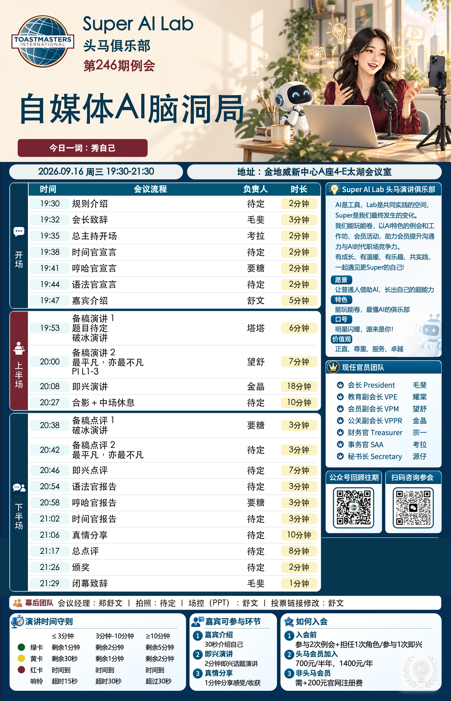

# 已认可的舒文版效果

Felix 已确认第246期最终采用图效果满意。参考图片：

这张图只用来理解版式；图中的人物、主题、日期、地点、演讲和时间属于当期内容，不能用于填补下一期缺项。图片尺寸2600×4034是该期内容排出的结果，不是固定尺寸要求。

## 沿用的方法

- 暖白主题横幅、藏蓝主体、酒红分段条；插画留在右侧，左侧为品牌和主题留白。
- AI只画主题插画；程序排品牌、主题、今日一词、日期地点、流程与幕后人员。
- 正文52px，长题目和长姓名换行增加行高，正式流程按内容分配高度；不为了固定画布压缩字号。
- 右侧简介、官员、二维码及底部规则复用已采用底图像素。新增高度只让幕后和底部整体下移，不重绘固定区域。
- 表格只显示正式环节。串场计入计算，但既不列行，也不写提示或说明。
- 总主持开场前直接衔接；开场后环节之间默认1分钟串场，最后结束后不再加。具体总分钟数每期重算。
- 空缺经用户接受后显示“待定”；演讲项目不冒充演讲题目。

日常换内容直接运行现有模板。只有用户提出视觉变化，才调整这套效果；已选中的成品保持原样。
